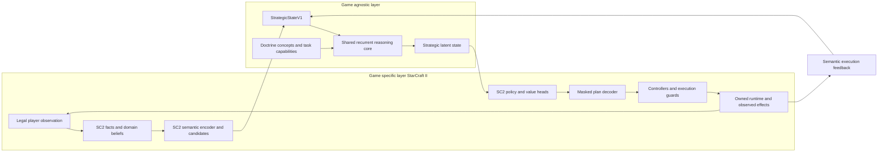

# Two layer architecture for strategic game control

Approved design direction, 2026-10-31. The application has **two logical layers**:
a game-agnostic strategy core, with military doctrine as its background decision
framework, and a game-specific layer whose first implementation targets
StarCraft II. Each module may contain several neural-network layers. The split
defines responsibilities and interfaces; it does not establish that learned
weights will transfer successfully between games.

The [doctrine review](doctrine-inspired-control.md) supplies the shared decision
process. The [RL architecture](rl-architecture.md) specifies the first StarCraft
policy, and the [training plan](rl-training-plan.md) defines its environment and
evaluation. Finish the [hardcoded milestone](hardcoded-elite-milestone.md) before
implementing or training the learner. This document introduces no runtime or
gameplay changes.

## Responsibilities

| Responsibility | Game-agnostic core | StarCraft II layer |
| --- | --- | --- |
| Knowledge | Facts, assumptions, evidence, uncertainty, courses of action, intent, decision questions and effects | Unit types, attributes, costs, technology, maps and source-linked SC2 inference rules |
| Beliefs | Shared evidence contract, aging semantics and competing explanations | Interpret legal observations; estimate aggression, economic commitment, technology and local force capabilities |
| Reconnaissance | Which uncertainty matters to a decision, useful reporting deadline and acceptable cost/risk | Choose eligible Probe/Observer, inspect production or mineral lines, evaluate route exposure and retain site evidence |
| Strategy | Compare possible actions, likely/dangerous enemy COAs, readiness, endurance and contingencies | Supply feasible objectives, targets and production/scouting options grounded in SC2 mechanics |
| Learned network | Shared recurrent reasoning over semantic state and previous observed effects | SC2 observation encoder, policy/value heads, conditional masks and deterministic plan decoder |
| Execution | Interpret feedback as accepted, overridden, failed, pending or achieved | Economy, missions, formation, micro, selection/ownership, ability opt-ins, resource guards and SDK integration |
| Assessment | Prediction quality, task performance, achieved effects, latency and resource sustainability | Define observable SC2 evidence: completed tech, arriving counters, weapon participation, income and match result |

Dependency direction is from the game adapter to core interfaces. The core
imports neither `sc2` nor the game packages, runtime or current SC2 plan types,
including through transitive imports. It does not know a Nexus tag or assign
meaning to a particular unit ID. It requests information and proposes intent
using shared semantics.
The game layer determines what those concepts mean in the current ruleset and
whether an action can actually be executed. Doctrine organizes decisions;
SC2 evidence and experiments determine counter roles, thresholds and tactics.

## Network composition

The game-specific module surrounds the shared core on both the input and output
paths. This is one composed policy with two architectural layers, not a proposal
for two independent policies issuing competing commands.



The first neural prototype retains the proposed 64-feature entity encoding,
128-feature pooled/scalar representations and 256-state GRU. The SC2 encoder
owns observation interpretation and normalization; the shared GRU owns recurrent
reasoning; SC2 heads own the first 34 action logits and scalar value estimate.
Those dimensions remain unbenchmarked design parameters. A future game's heads
can have a different action space while using the same versioned core interface.

## Shared contracts

`StrategicStateV1` is a proposed semantic input, distinct from the SC2 domain view
called `BeliefStateV1` in the initial RL document. It includes:

- Participants and relationships, controlled capabilities, objectives and
  deterministically identified candidate entities/locations/actions.
- Relevant facts and estimates, evidence identities, age, uncertainty and missing
  or unsupported-feature masks. Unknown strength cannot become numeric zero.
- Competing enemy COAs, supporting/contradicting evidence, likely consequences
  and the questions that distinguish them. Heuristic support is not automatically
  a calibrated probability.
- Resources and sustainable capacity expressed in declared semantic units,
  readiness and response lead times, permitted control and constraints.
- Current intent, commitments, decision deadlines, previous decisions and their
  observed execution feedback, plus elapsed decision time and episode boundaries.

The vocabulary and feature meanings belong to the shared contract. Each game
adapter documents how it derives and normalizes them, including which evidence
supports inferred values. An arbitrary unit embedding does not become portable
merely by having the expected width. Quantities with different meanings, such as
SC2 supply and combat effectiveness, remain distinct. A game without production
or hidden information marks those features unsupported or supplies its legally
known facts; it need not simulate SC2 mechanics.

Candidate handles stay opaque, with full IDs outside neural tensors; the SC2
adapter retains the mapping to actual unit tags and positions.
Do not feed raw SC2 unit/race/build identifiers, game-specific profile names or a
game-ID token to the shared core. The adapter may use legally observed unit types
to derive capabilities. Configured opponent builds, seeds, future observations
and evaluation-oracle state remain separate metadata in every layer. Recurrent
state is isolated per environment and controlled participant even when weights
are shared. It resets at episode boundaries, including when the next episode
uses a different game. Time units and normalization are explicit adapter contracts;
SC2 game loops and its two-second director cadence are not universal constants.

The shared reasoning output is a latent state from which the game layer selects
grounded options. The resulting semantic intent records purpose, desired effect,
target reference, allocated capability/resource budget, deadlines, constraints
and replanning conditions. This information accompanies the executable plan;
it does not grant command permissions.

`DirectorActionV0` remains **SC2-specific**: seven objective, sixteen target,
seven production-posture and four scouting logits. Another adapter defines its
own heads and decoder. Legal masks apply during sampling and execution, with
active heads and original likelihoods retained for training. The SC2 decoder
continues to produce `StrategicPlan` for the existing controllers, which retain
their independent authority to reject stale or impermissible commands.

For example, the shared intent may be to withdraw while preserving force and
useful supporting effects. The SC2 controller calculates whether ranges,
cooldowns, closing speed, terrain and visible effects allow a firing opportunity
with an exit; otherwise it uses the existing escape behavior. Another game's
adapter supplies its own realization of the intent. This separates the reusable
decision from the game mechanics; the proposed SC2 withdrawal tactic still needs
its own targeted test before adoption.

## Ontology and module boundary

Keep a portable decision ontology for COA, evidence, uncertainty, intent,
information requirement, readiness, sustainment and performance/effectiveness.
Keep a separate SC2 ontology for units, tech paths, damage/range, build times,
scout methods and domain inference rules. The existing
[`game_ontology.v1.json`](../source/data/game_ontology.v1.json) is SC2 domain
knowledge; it must not be relabeled as a universal game ontology.

The following package split is a migration target, not existing delivered code:

```text
source/strategy_core/          # semantic contracts, doctrine, shared network
source/games/starcraft2/       # observation encoder, domain beliefs, heads, decoder
source/training/              # collection and learning orchestration for the pair
source/runtime.py             # existing reviewed SC2 SDK-private boundary
```

Training orchestration supports the composed policy and does not introduce a
third policy layer. The current `Assessment`, `StrategicPlan`, `OpponentBeliefs`
and rule policies carry SC2 concepts even where they avoid SDK imports. Preserve
their behavior and serialized records during the hardcoded improvement cycle;
map them through explicit converters when the shared contracts are implemented.
Keep SDK-private calls in `source/runtime.py` and preserve the pinned packages.

## Training and transfer

After the rule bot earns acceptance, train the SC2 encoder, shared core and SC2
heads together through the documented teacher/BC/PPO stages. Teacher labels still
need representability checks against the SC2 decoder. Log both the shared semantic
input and the SC2 decoded action, guards and observed effects. Doctrine metrics
begin as diagnostics; confidence changes and completed tasks do not automatically
earn reward.

For another game, implement and validate its observation/semantics converter,
candidate builder, heads, action decoder, rules/permissions, outcome semantics
and reset/step/close lifecycle. For frozen-core transfer, compare the pretrained
core with a frozen randomly initialized core while training identical new-game
adapters. For fine-tuning, compare transferred and freshly initialized cores
with the same trainable modules. Match data/compute budgets and architectures,
record seeds and optimizer steps, and recheck StarCraft retention.
Architectural reuse, useful weight transfer and zero-shot generalization are
different claims, each requiring its own evidence.

Manifests identify core/adapter/ontology/feature/action/decoder versions, separate
core and adapter checkpoints, normalization, teacher, game/ruleset, reward/time
conventions and dataset split. Split complete episodes and keep per-game/domain
calibration and acceptance results. Games outside SC2 do not inherit the current
SC2 win/draw reward interpretation or Windows/Linux compatibility assumptions.

## Staged delivery

1. Record this approved boundary now while hardcoded SC2 repairs continue on
   their own frozen experiment branches.
2. After the hardcoded milestone, implement the semantic contracts/converters
   and import/dependency checks. Synthetic adapter doubles should expose leaked
   unit IDs, unsupported features, stale evidence and mismatched units.
3. Build the first SC2 composed network and transition collector. Check masks,
   teacher round trips, reset/cleanup and actual effects before training.
4. Earn SC2 strength through targeted trials, retention and holdouts.
5. Add a chosen second game through its adapter and measure transfer and SC2
   retention before describing the learned core as effective across games.
