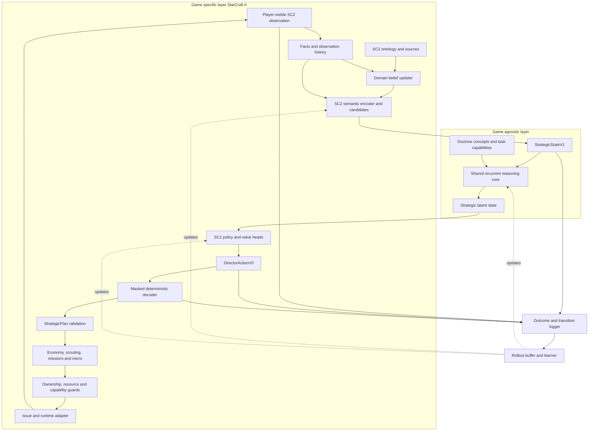

# Belief-state reinforcement learning architecture

Version 0.2 — 2026-10-31. **Two-layer design approved; no RL policy has been trained.**

Priority update: finish the [hardcoded bot milestone](hardcoded-elite-milestone.md)
before implementing/training this learner. An accepted frozen rule bot will then
provide a teacher and training opponent; current R2 failures must not be labeled
expert behavior.

The separate [training and environment plan](rl-training-plan.md) defines teacher
collection, isolated public opponents, Linux container and retail compatibility
gates, rollout accounting and staged BC/PPO acceptance.

The approved [two layer architecture](game-agnostic-architecture.md) separates a
game-agnostic doctrine/reasoning core from the StarCraft-specific observation
encoder, policy/value heads, decoder and execution adapter. The
[doctrine framework](doctrine-inspired-control.md) supplies enemy courses of
action, intent, decision-linked reconnaissance, sustainment and assessment.
Individual mechanisms and numerical weights still require SC2 evidence.

The first learned controller composes both layers while retaining the current
execution boundary. The StarCraft encoder converts legal observations and domain
beliefs into the shared semantic state. The recurrent core produces a strategic
latent state; StarCraft heads emit the action vector. Its deterministic decoder
produces a `StrategicPlan`, and existing controllers execute through `issue`.

The source-linked [game ontology](../source/data/game_ontology.v1.json) defines
SC2 concepts and relationships. Portable doctrine/decision concepts belong to a
separate shared ontology. The [belief/scouting design](opponent-beliefs-and-scouting.md)
defines how evidence changes those beliefs. Neither the ontology nor a confident
estimate is an omniscient world state. A learned dynamics model is a later,
separate component.

## 1. Design decisions and research basis

| Decision | Research inspiration | Adaptation here |
| --- | --- | --- |
| Treat strategy as a partially observable, long-horizon problem | [SC2LE, Vinyals et al.](https://arxiv.org/abs/1708.04782) describes SC2 observations, actions, delayed rewards and the difficulty of learning full games | Keep history, evidence age and missingness; begin above raw unit micro |
| Encode entities and retain recurrent memory | [AlphaStar, Vinyals et al.](https://doi.org/10.1038/s41586-019-1724-z), and the [authors' overview](https://deepmind.google/blog/alphastar-grandmaster-level-in-starcraft-ii-using-multi-agent-reinforcement-learning/), use entity processing, recurrence and structured actions | Start with a small entity encoder plus GRU/LSTM; retain our domain-specific plan decoder |
| Start with a comprehensible on-policy learner | [PPO, Schulman et al.](https://arxiv.org/abs/1707.06347) alternates experience collection and surrogate-objective optimization | Recurrent PPO with the clipped surrogate is the initial algorithm choice, not a claim that this implementation exists or that a particular library already supports every required head/mask |
| Mask invalid actions during sampling and learning | [Huang and Ontañón](https://arxiv.org/abs/2006.14171) study validity masking in policy-gradient methods | Store the actual conditional masks and compute likelihoods under those masks; still revalidate at execution |
| Treat recurrent state and sequence boundaries explicitly | [R2D2, Kapturowski et al.](https://openreview.net/pdf?id=r1lyTjAqYX) studies recurrent-state handling with replay | Store episode boundaries and recurrent state; use sequence burn-in if replay is introduced. R2D2 is not the proposed first learner |
| Separate terminal outcomes from external time limits | [Gymnasium's time-limit guidance](https://gymnasium.farama.org/v0.26.3/tutorials/handling_time_limits/) distinguishes termination and truncation for bootstrapping | A budget cutoff is censored experience, not an invented defeat or draw |
| Defer imagined rollouts until state estimation is trustworthy | [DreamerV3, Hafner et al.](https://arxiv.org/abs/2301.04104) learns dynamics and trains behavior using imagined trajectories | Investigate a learned world model after the model-free baseline; do not treat our rule-based belief ranges as a trained simulator |

These are design inspirations. Their published results do not establish this
bot's strength, sample efficiency, hardware needs or performance on retail 5.0.17.
PPO, recurrence, action masking and our decoder must be integrated and tested as
one system; they are not assumed to be a ready-made combination.

## 2. Architecture and repository boundaries



| Boundary | Architectural owner | Current foundation and proposed addition |
| --- | --- | --- |
| Decision concepts | Game-agnostic core | Proposed portable ontology/contracts for evidence, COAs, intent, information requirements and effects |
| Domain knowledge and beliefs | StarCraft layer | `game_ontology.py`, SC2 JSON catalog, `opponent_beliefs.py`, `scouting.py`, `GameAssessment`; map `BeliefStateV1` into shared `StrategicStateV1` |
| Recurrent reasoning | Game-agnostic core | Proposed shared network; the current `StrategicDirector` is a rule-policy seam with SC2 contracts |
| Heads and decoding | StarCraft layer | SC2 policy/value heads and conditional masks; decode `DirectorActionV0` through `validate_plan` |
| Execution | StarCraft layer | Retain missions, intents, economy, abilities and `issue` for the first learner |
| Environment | StarCraft layer | Retain pinned SDK boundary in `runtime.py`; add a public training environment wrapper |
| Evidence | Both, through versioned records | Log shared semantic input and SC2 actions/guards/effects alongside recurrent state and likelihoods |

`Assessment`, `StrategicPlan` and the current belief ontology are SC2-specific
even where they avoid SDK imports. Implement explicit converters rather than
relabeling them as portable. Shared code must not import SC2 identifiers or infer
game mechanics from a raw unit/profile ID. Training/logging supports both modules
without adding a third policy layer. Another game supplies its own encoder,
heads, decoder and environment; transferable weights require separate evidence.

Some belief/ontology code is currently an initial implementation under validation.
The RL encoder, environment, learner, rollout buffer, trained weights and league
are proposed additions. They must not be described as delivered capabilities.
No competing package that installs `sc2` or `s2clientprotocol` is introduced into
the current environment to obtain an RL wrapper.

The first [computed strategy baseline](evaluations/2026-10-31-strategy-belief-baseline.md)
contains all 30 R2 repeats and the separate extended comparison. The working tree
also contains experimental cost-aware scouting and bounded belief-driven target
transfers. They have synthetic coverage; R2's historical wins do not validate
these later changes. Freeze and test them separately before a gameplay promotion.
The subsequent `belief-gate-v1-20261031` live triplet lost all three Zerg Timing
games at 820.4 seconds and was rejected. Runtime now retains belief telemetry but
uses R2 scouting and disables belief-driven plan control by default. Cost-aware
scouting remains in an explicitly experimental controller. Rule-bot playing
strength, rather than RL implementation, is the current milestone.
Software validation is recorded per frozen revision in the milestone record.
The wheel includes the exact SC2 ontology JSON. Those checks do not train an RL
policy or establish playing strength or cross-game transfer.

## 3. StarCraft state and shared state

The StarCraft adapter constructs `BeliefStateV1` only from information available
to our participant at that decision. Its semantic encoder produces the shared
`StrategicStateV1` defined in the two-layer design. The table below describes the
SC2 domain view; raw SC2 IDs and resource conventions do not pass directly into
the shared network. Each inferred dimension carries its estimate,
uncertainty, evidence age and provenance. Unknown values have an explicit mask;
encoding a missing value numerically as zero must never mean “enemy strength zero.”

| Block | Contents | Important distinction |
| --- | --- | --- |
| Own economy | Bank, income estimates, workers, resource sites, reserves, supply and production queues | Available resources are separate from reserved funds |
| Own force | Unit types, health/shields, position, upgrades, cooldown/research facts | Selected/released actors and permitted capabilities remain explicit |
| Opponent commitments | Aggression and economy support, uncertainty, independent evidence | Both commitments can be high; they are not complementary labels |
| Technology | Air, armored-ground, light-ground and cloak/detection hypotheses | A structure permits a path; it does not prove a completed army |
| Enemy army | Visible supply lower bound, retained sightings, uncertain estimate/range | Supply strength is separate from local weapon/terrain-aware fighting strength |
| Relative strength | Own-versus-enemy supply range plus current local engagement evidence | No-contact sentinels do not establish superiority |
| Spatial knowledge | Public map topology, known starts/sites, occupied/inspected/unknown areas, last-seen contacts | Previously empty locations become uncertain with age |
| Scouting | Current questions, scout assignments, costs, confirmed losses, possible missing units and inspected locations | Returning alive does not prove the question was answered |
| Current execution | Active plans, squads, assignments, expiries, recent accepted/rejected intents and observed effects | An accepted order is not a verified game effect |

The initial belief updater is a transparent heuristic. Its uncertainty values are
not calibrated posterior probabilities or statistical confidence intervals.
Calibration against recorded evidence and separate evaluation truth is a required
milestone, not an implication of using the word “belief.” The ontology must mark
facts, inference rules and experimental coefficients separately.

### Provenance and state updates

Every update records the observation loop, evidence identity, source/type, last
positive observation, inference-rule identifier and relevant ontology revision.
One sighting cannot increase confidence each time it is reread. Fresh evidence
about one unit must not refresh all old technology or every remembered unit.
Known deaths remove those specific contacts; an unobserved area supplies no
negative evidence about a hidden army or hidden tech.

The actor never receives the configured computer build, random-seed identifier,
future observations, replay outcome, or an omniscient enemy state. Such metadata
belongs to sampling, evaluation and reproducibility records. If privileged labels
or a privileged critic are investigated later, their data path must be separate
and leakage-tested. Start with a critic using the same partial-information view.

### Encoder and memory

The SC2 layer supplies normalized semantic scalar features and pooled entity
encodings for own units, enemy sightings and candidate locations. Include age,
visibility, uncertainty, control permissions and domain masks. The shared layer
adds a small GRU/LSTM over consecutive decisions and a shared representation of
previous intent and observed effects; raw SC2 action indices stay in its adapter.
Persistent explicit beliefs complement recurrent memory; neither replaces the
other. Keep the initial architecture small enough for local inference and measure
latency under actual concurrent-game load.

A concrete prototype budget places 64 features per encoded entity, masked pooling
into 128 features per entity set and a 128-feature scalar encoder in the SC2
module, with one 256-state GRU in the game-agnostic module. SC2 policy and value
heads consume the shared recurrent output. These are starting design
parameters, not benchmarked hardware requirements. Truncate entity sets with a
deterministic relevance order, retain overflow counts, and record the truncation
mask. Include uncertainty for omitted contacts rather than silently treating
them as absent. Learn normalization only on training data and freeze it for
evaluation. The explicit belief vector is an approximate summary of observation
history; it is not assumed to be a sufficient Markov state.

## 4. First action vector

The first policy should choose strategy, targets, production posture and scouting
questions. It should not learn raw mouse/keyboard commands, direct SDK calls,
arbitrary Python, actor ownership rules or ability permissions.

Proposed `DirectorActionV0` is the **SC2 adapter's** interface, with **34 logits**
and fixed, versioned ordering. It is not the universal action space for other games:

| Head | Width | Meaning and decoding |
| --- | ---: | --- |
| Objective | 7 | Develop, stabilize, recover, pressure, counterattack, contain, finish |
| Primary target | 16 | Home, rally, threat and up to thirteen public-evidence candidates; pad/mask missing entries; retain canonical IDs outside the network |
| Production posture | 7 | Keep current, ground screen, general ranged, anti-air, anti-armor, anti-light, rebuild; each selects a versioned, bounded target template |
| Scouting question | 4 | Commitment, technology, army, expansions |

All four heads are categorical. The executed action is four sampled indices;
34 is the policy-logit count, not the number of sampled actions. A separate
SC2 scalar value head predicts its configured return. Production templates are converted into
feasible bounded integer targets using ontology roles and current permissions;
their exact weights belong to the versioned decoder. Target membership and ordering
are deterministic at a given observation. The decoder logs both the original
vector and its projected plan, including rounding, caps and fallback reasons.
The first SC2 decoder retains existing mission allocation and macro priority
rules. Scout-method selection needs its own validated controller; the rejected
cost-aware draft is not an accepted execution component. All four heads require
the documented decoder before they can govern the current director.

Sample objective first, then its conditional legal target, production posture
and scouting question. Store the sum of active conditional log probabilities as
the joint action likelihood. Unused heads contribute zero to that sum; a forced
home/rally choice has probability one under its mask. For example, recovering
cannot accidentally decode to an attack on an economic target. Reserve target
slots 0/1/2 for home/rally/threat, masking threat when absent; rank other
candidates deterministically and retain their full IDs in the transition record.

An optional later `DirectorActionV1` adds three role-allocation values, five
economic-priority values, eight scout-target logits, three scout-method logits
and one commitment-duration value: **54 action scores/values total**. This count
excludes the value estimate and any learned distribution-scale parameters.
Continuous allocations require an explicit bounded distribution, stored
likelihood and projection rule before PPO can train them. Those heads require
explicit executor/contract extensions and separate acceptance. A larger action
space is not automatically a better learner.

### Projection and legal-action masks

The decoder enforces supported objectives/targets, disjoint squad budgets, plan
age/expiry, configured production permissions, base/worker ceilings, resource
reserves and current actor eligibility. It distinguishes an allowed future tech
goal from a presently legal train/cast command. A future-tech plan can be valid
while its immediate execution remains gated by completed prerequisites, power,
available abilities and resources.

Combat spells remain individually opt-in. The model cannot switch those
permissions on, claim a human-owned unit, bypass `issue`, or manufacture resources
by “reserving” them. Emergency defense and current ownership checks can revoke an
older proposal. There is always a legal hold/current-plan fallback; missing
information must not produce an invalid all-masked categorical distribution.

Masks are recomputed for execution because units, resources and ownership can
change during inference. Record sampling-time masks, conditional head usage,
sampled-action likelihood and any execution-time override separately. PPO's loss
uses the distribution that actually sampled the action, not an unmasked or
renormalized substitute. Safety projection is never replaced by a reward penalty.

## 5. Scouting as an information action

Scouting should resolve a decision: whether to defend before expanding, prepare
anti-air, add armored-ground counters/detection, locate a missing force, or deny
new income. The policy sees uncertainty and chooses a question; the initial
planner chooses an eligible method, route and destination.

Candidate utility combines decision relevance, uncertainty and expected useful
visibility, then charges travel time, worker opportunity cost, observed exposure,
replacement cost and recent losses. Initial coefficients are documented
heuristics; they are not claimed expected-value estimates. Confirmed losses,
temporarily missing scouts and estimated opportunity costs stay separate.

Do not reward an internal confidence number falling by itself. Useful information
must come from independent observations and improve a verifiable prediction or
decision. Repeatedly revisiting an already visible tile or restating an old tech
sighting earns no information credit. Cost-aware scouting and its policy can
later be learned through the same action interface and outcome records.

## 6. Environment, time and experience records

This section specifies the StarCraft adapter. Other games define their own legal
observations, action timing, outcome semantics and environment lifecycle while
preserving shared state/intent/feedback contracts.

Use the native Windows runtime and newest installed binary first, with recorded
ping/data identity. Training automation uses owned local matches, not Battle.net
ladder attachment. Environment closure only cleans up owned clients. The global
limit remains **eight live SC2 clients**; a future self-play setup must count its
actual clients per environment rather than assuming eight simultaneous matches.

Begin with strategic decisions at the existing director cadence, then benchmark
one- versus two-game-second decisions. Micro and ownership checks continue at the
observation cadence. These cadences are experiment parameters, not established
optimal values. Late inference retains a still-valid plan or falls back to rules;
it cannot block the game loop indefinitely.

Log a transition at every policy decision:

```text
episode / source / core / adapter / shared-and-domain-ontology versions
feature / action-schema / normalization versions
SC2 observation loop, elapsed game time and declared semantic time units
SC2 belief view + shared StrategicStateV1 + entity/candidate masks + capabilities
recurrent input state and sequence/reset flags
sampled vector + active heads + masks + old log probability + value estimate
decoded plan + projection/rejection/override reasons
issued intents and subsequently observed effects
reward components + next belief state
terminated / truncated / infrastructure-error reason
map / binary-data / dependency / seed / opponent-pool identities (metadata only)
```

Current five-second snapshots are useful for diagnostics and coarse imitation.
They are **not** PPO rollouts: they lack policy likelihoods, sampling masks and
the required decision-by-decision transition/reward record. Build the transition
logger before attempting policy-gradient training.

### Termination versus truncation

A completed victory/defeat is terminal. An externally imposed duration is a
truncation; bootstrap value according to the chosen return estimator rather than
inventing a terminal loss. Genuine in-game draws must be distinguishable from
budget cutoffs. Infrastructure errors are quarantined from learning outcomes.
See [Gymnasium's guidance](https://gymnasium.farama.org/v0.26.3/tutorials/handling_time_limits/).

This is already material to this repository: increasing the bound from 1500 to
3600 seconds resolved reference Zerg Timing as three wins around 1515 seconds,
while R2 lost all three around 1205. The higher bound exposed a regression; it
did not improve R2. Keep original censored records and the new comparison group.

Account for variable decision intervals using a time-based discount, for example
`gamma(delta_t) = exp(-delta_t / tau)`, with `tau` selected experimentally. A
short-step discount copied from another game can erase credit for decisions made
minutes before the outcome. Sequence training keeps episode boundaries, initial
hidden state and any burn-in explicit; minibatches must not join unrelated games.

## 7. Learning objective and opponent pool

The following reward contract applies to the first SC2 policy. Reward/outcome
interpretation and the scalar value head belong to the game adapter; the shared
core does not assume every future game has the same terminal outcomes or time units.

Start with terminal victory/defeat reward and a value baseline. A true draw has
its own result; a truncation is handled through bootstrapping. Add dense shaping
only after an ablation demonstrates benefit without changing the intended goal.

The initial reward contract is victory `+1`, defeat `-1`, genuine draw `0`, and
zero intermediate reward. A truncation supplies no fabricated terminal reward.
Bootstrap its final observation with the value model, then reset recurrent state
for the next episode; resetting the environment must not leak into a bootstrap
on the new game's initial observation. Apply a time-aware eligibility/GAE decay
as well as time-aware discounting when intervals vary. Entropy, auxiliary belief
losses and reward shaping are separate coefficients with logged ablations.
Candidate diagnostics include resource trades, economic damage, defense readiness,
scout costs and prediction quality. They are not all automatically policy rewards.

Do not pay for purchases, queued commands, survival alone, repeated expansion
visits or self-reported confidence. Those can reward spending without a useful
army, stalled games or fabricated certainty. Information and belief losses should
initially be auxiliary supervised/evaluation objectives, using only properly
separated targets; the actor cannot change its own grading labels.

Recurrent PPO is the first learner. A rule-policy/teacher warm start is optional,
but R2's demonstrated Timing regression must not become an unquestioned expert
label. Log legal alternatives and failure examples. Use actual SC2 interaction
for playing-strength evidence; a synthetic test harness is not an accepted game
simulator.

Train against an explicit mixture of computer race/build/difficulty conditions
and frozen policies. Track per-opponent retention to avoid cycling between
counters. Later consider a checkpoint/opponent league and exploiters, inspired
by [AlphaStar's training account](https://deepmind.google/blog/alphastar-grandmaster-level-in-starcraft-ii-using-multi-agent-reinforcement-learning/).
League/self-play infrastructure and a learned world model are later stages, with
their own compute and evaluation decisions.

## 8. Metrics and acceptance

| Area | Measures | Failure the metric should expose |
| --- | --- | --- |
| Strategy estimation | Accuracy/coverage by horizon, time-weighted Brier error, false confidence, recognition lead | Correct classification only after the attack or unjustified certainty in fog |
| Belief axes | Evidence age/coverage, uncertainty calibration where truth is available, prediction consistency | One fresh sighting refreshing unrelated beliefs; unobserved mistaken for absent |
| Counterbuild decision | Published role-fit score, target-budget feasibility, plan changes and reasons | An unsuitable response despite adequate information |
| Delivery | Counter units and prerequisite tech present when needed, response latency | A good desired composition that is never produced |
| Scouting | New relevant facts, answered questions, time/cost, confirmed losses and missing reservations | Expensive scouting that returns no useful information |
| Execution | Invalid/rejected intents, mask/projection/override rates, latency, ownership/reserve violations | A policy relying on illegal actions or stale plans |
| Playing strength | Resolved outcomes by scenario, completion time, trades and economic losses | Better proxy scores without stronger play |

Configured AI build labels are an evaluation reference, not complete truth about
a changing mixed strategy. Global enemy-army accuracy needs separately collected
evaluation truth; player observations alone cannot certify the unseen total.
Do not fabricate that ground truth from later sightings or the current estimate.

Separate train/development/held-out games by full match, seed, map and opponent
policy. Never split adjacent frames of one replay across train and test. Three
fixed-seed repeats measure reproducibility, not three independent strategic
conditions. Freeze code, ontology, model and settings within each evaluation.

Use three-repeat targeted rejection gates first. Only a candidate that improves
its target earns broader retention tests. Current R2-winning groups are Terran
Air/Macro/Power and Zerg Air/Macro/Power/Rush; Zerg Timing is a known regression
against the extended reference. Terran Rush/Timing remain failures. The proposed
multi-map/multi-seed holdout is not yet an executed validation result.

## 9. Implementation phases

1. **Belief and ontology foundation:** validate source-linked concepts, per-fact
   aging, unknown masks and immutable serialization. Add cost-aware scouting and
   published estimation/build/readiness metrics; establish recorded-state baselines.
2. **Offline policy seam:** implement/version shared `StrategicStateV1` and the
   SC2 `BeliefStateV1` converter, candidate ordering, SC2 heads/`DirectorActionV0`,
   masks and decoder. Test the import/semantic boundary, resource conservation,
   actor ownership, stale evidence and fallback behavior without launching SC2.
3. **Transition logger and environment:** verify reset/step/close, actual action
   effects, recurrent boundaries and terminal/truncation handling on local matches.
   Keep the SDK-private adapter pinned and run its lifecycle/protocol tests.
4. **Small learned baseline:** optional imitation warm start, then recurrent PPO
   with limited heads and a frozen opponent mixture. Compare with both the current
   rule policy and relevant earlier winning references.
5. **Targeted improvement and retention:** promote only after improved resolved
   outcomes, legal execution and retention of established winners. Track all
   infrastructure failures and intentionally aborted trials separately.
6. **Generalization and optional expansion:** evaluate unseen maps/seeds/policies;
   add another game's adapter and compare transferred versus fresh core weights,
   checking SC2 retention. More heads, leagues and learned dynamics need their
   own evidence; architectural separation alone does not establish transfer.

The first implementation task is the belief/decoder/data contract, not a large
training cluster. Dependency selection and learner hyperparameters remain open
until a small reproducible prototype can be measured. Shared human-control
acceptance remains a separate prerequisite for deploying any policy as a human
assistant; autonomous wins do not establish mouse, keyboard or selection behavior.
