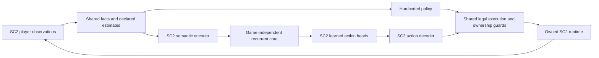

# Parallel rule and learned policy tracks

Architecture review, 2026-10-31. The user requested one hardcoded policy, developed
elsewhere, and a learned policy maintained as a parallel track. The learned track
starts its curriculum against Easy opponents. Its training progress, checkpoints
and evaluation history are independent of the hardcoded policy's acceptance.

The existing two-layer split remains inside the learned policy: an SC2 encoder
and action decoder surround a game-independent recurrent core. Rule and learned
policies are alternative controllers selected for a match. Each match has one
controller with authority to propose actions.

## What the current prototype actually reuses

The current implementation is a hybrid learned director. `TrainingAssistant`
inherits `RuntimeAssistant` and replaces `tactics.director`; the surrounding
assessment, macro, mission, scouting and micro controllers continue to run.
This is broader reuse than sharing a connection to SC2.

| Component | Existing code reused by RL | Consequence today |
| --- | --- | --- |
| Runtime and game mechanics | `runtime.py`, pinned BurnySC2/protocol integration, game-data/command compatibility, owned process lifecycle | Same legal player API and exact binary/map identity |
| Ownership and execution guards | `assistant_control.py`, `EconomyAssistant.issue`, reserves, prerequisites, selection/release eligibility, ability opt-ins and order budgets | Model proposals retain the existing command boundary |
| Facts and state estimates | `scouting_facts.py`, `scouting.py`, `opponent_beliefs.py`, `game_assessment.py`, SC2 ontology | Observations are shared; some beliefs, local power and opportunity values are heuristic estimates |
| Strategic choices and projection | `action_codec.options` calls `strategy_policies.candidates`; `decode` calls `compose` | Existing attack thresholds and retreat/defense judgments restrict the model's choices; mission budgets and expansion decisions are partly rule-produced |
| Economy and technology | `economy_assistant.py`, composition/profile targets, production templates | Worker/base/tech/upgrade spending priorities and openings are hand-coded; the model adjusts bounded production postures |
| Unit and squad execution | `missions.py`, `army_waves.py`, `tactics.py`, `warp_reinforcement.py` | Formation, movement, target selection, cooldown micro, local retreat and reinforcement remain scripted |
| Reconnaissance execution | Baseline `ScoutController` | Scout routes/timing are scripted; the policy's question head is masked because this controller does not consume its requests |

The neural network learns a recurrent representation and distributions over the
supported strategic objective, target and production-posture choices. It has not
learned a complete build order, economic controller or unit micro policy. The
first VeryHard pilot measures this specific hybrid and remains archived with its
source identities and limitations.

## Proposed independent policy boundary

Common infrastructure should expose observations, SC2 mechanics, legal actions,
ownership/resource constraints and execution feedback. Each policy should own
its gameplay decisions. In particular, a judgment such as "attack only above this
army threshold" or "retreat below this health ratio" is a policy decision; it
should not be presented as SC2 action legality in the learned track.

The rule policy can retain its strategic heuristics and existing development
process. The learned policy needs its own decoder/candidate builder which offers
mechanically supported choices without importing the hardcoded director's
preferred attack, retreat, counterbuild or spending decisions. Resource reserves,
unit ownership, ability permissions and stale-target validation remain enforced.

Reusable execution skills also contain behavior. A fixed worker allocator,
building placer or combat-micro controller is therefore an explicit, versioned
part of the RL environment. Sharing these skills is a practical initial scope;
it does not mean the model learned them. Changes from the hardcoded development
track enter RL through a separately frozen environment revision and evaluation.

## Control scope for the revision

The model's intended control scope is being clarified with the user. These are
distinct experiments and should carry different action/decoder versions:

| Scope | Learned decisions | Fixed behavior |
| --- | --- | --- |
| High-level director | Strategic objective, target and bounded production posture | Economic priorities/openings, squad allocation, scouting routes and unit micro |
| Strategy and economy, recommended next boundary | Objectives, targets, economy/tech/composition goals, expansion and resource allocation; scouting goals when supported | Mechanics/guards and explicitly selected execution skills such as worker allocation, placement and unit micro |
| Strategy, economy and unit micro | The above plus unit-level action selection and combat timing | Mechanics, observation legality and ownership/resource/ability guards |

The recommended scope requires extending the current 34-logit action contract:
its small production-posture head cannot express a complete economic policy.
The revised contracts must define which macro choices and execution skills are
learned, their sampling likelihoods, legal masks and observed effects before
collecting new training data. Existing v0 checkpoints and rollouts remain frozen;
they are not relabeled as experience from the revised policy.

## Training and evaluation ownership

- Easy is the current learned-policy curriculum. Difficulty does not increase
  automatically, and poor early results do not terminate the RL track.
- Learned-policy checkpoints are compared within their curriculum and declared
  budgets, with separate training/development worlds and complete-episode splits.
- The hardcoded track has its own benchmarks and promotion process. RL training
  does not require that policy to finish first, win a comparison, or serve as a
  teacher. Imitation would be an explicit additional experiment with honest
  teacher quality and representability labels.
- Shared executor and feature versions, source identities, seeds, game domain,
  sampling masks and original outcomes accompany each frozen batch. All live
  workers share the global eight-client limit and existing ownership safeguards.

New Easy training follows the clarified control scope. The design audit itself
changes no gameplay code or existing checkpoint.
