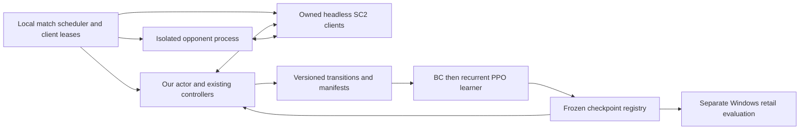

# RL training and environment plan

Version 0.2, 2026-10-31. **Training design; implementation follows the hardcoded
bot milestone.** Use headless Linux containers as the eventual rollout target,
subject to game-domain validation and a measured throughput pilot. Keep native
Windows retail play as the current acceptance authority.

The prerequisite is the [hardcoded milestone](hardcoded-elite-milestone.md):
built-in AI reliability followed by established community opponents, with frozen
source and reproducible acceptance. The current bot is not an accepted expert.
After acceptance, freeze the teacher before collecting imitation data. The
[RL architecture](rl-architecture.md) defines the belief state, recurrent policy,
34-logit `DirectorActionV0` and guarded `StrategicPlan` decoder; this document
defines how to collect, train and evaluate that system.

The approved [two layer design](game-agnostic-architecture.md) places doctrine and
recurrent reasoning in a game-agnostic core. StarCraft owns its domain beliefs,
semantic encoder, policy/value heads, action decoder and environment. Training
orchestration records and updates this composed policy; it is not a third policy
layer. The first learner is trained on SC2 after the hardcoded gate. Another game
requires its own adapter and measured transfer, rather than a renamed SC2 schema.

## Recommended deployment

**Eventually use an x86-64 Linux host with headless containers for rollout
workers, and a separate learner process that can use a GPU.** Ubuntu is a
reasonable host choice. This is an engineering recommendation to measure, not
evidence that Ubuntu or containerization is fastest on this machine. Begin with
the demonstrated SC2 container dependency base rather than making an Ubuntu SC2
image a requirement: AI Arena's current recipe uses `debian:bookworm-slim` and
downloads `SC2.4.10.zip`.
[AI Arena SC2 image recipe](https://github.com/aiarena/aiarena-docker-base/blob/master/docker/Dockerfile.sc2)

Use raw observations/actions without requesting rendered images for the first
strategic policy. Start game workers and small-policy inference on CPUs; measure
the learner before buying GPU capacity. Blizzard documents separate rendering
options and notes that Linux runs offline, with map/replay dependencies provided
locally. A reproducible worker therefore needs its map dependencies as well as
the executable.
[Blizzard Linux API setup](https://github.com/Blizzard/s2client-proto/blob/master/docs/linux.md)

Keep native Windows retail play as the acceptance authority. The current
`runtime.inspect_installation` explicitly rejects Linux; the human CLI attaches
to an idle loopback client and creates a game. It is not a ladder `JoinGame`
adapter and will not work in a headless container unchanged. Later add an explicit
training-only runtime mode behind public interfaces. Keep SDK-private integration
in `source/runtime.py`, preserve the human-play platform/selection/ownership
guards, and retain `burnysc2==7.3.0` / `pys2clientprotocol==1.0.2` in our bot's
environment. Foreign bots run in their own dependency environments.

Proposed topology:



AI Arena provides a useful orchestration reference: its GPLv3 match controller
separates match preparation, SC2/websocket handling and bot launching, and can run
locally without downloading assets or uploading results.
[Match-controller overview](https://github.com/aiarena/sc2-ai-match-controller)
The local-play Compose example separates SC2, two bot controllers and a proxy,
with local logs/results/replays. Its `v0.8.0` image tags are reference examples,
not approved pins for our implementation; resolve and record immutable digests
after validation.
[Local-play Compose](https://github.com/aiarena/local-play-bootstrap/blob/main/docker-compose.yml)

Prefer explicit internal service addresses and nonoverlapping port leases.
Host networking is an option to benchmark: Docker supports it on Linux and as an
opt-in feature in Docker Desktop 4.34+, with documented limitations. It is not
universally unavailable on Windows. Do not expose a game API publicly merely to
connect an actor to its owned match.
[Docker host-network documentation](https://docs.docker.com/engine/network/drivers/host/)

## Patch and game-domain gate

Blizzard's published Linux download list reaches 4.10. AI Arena's `sc2patch`
modifies maps to reproduce newer balance on that engine and identifies its maps
with an AIE suffix. These are explicit differences from this repository's current
Windows retail 5.0.17 domain, not evidence of engine parity.
[Blizzard downloads](https://github.com/Blizzard/s2client-proto#downloads),
[AI Arena compatibility-patch description](https://github.com/aiarena/sc2patch)

| Domain | Intended role | Required interpretation |
| --- | --- | --- |
| Windows, exact retail binary/data and unmodified benchmark map | Current rule-bot acceptance; final learned-policy transfer evaluation | Preserve the installed binary and existing runbook; record exact ping/data identity. |
| Linux 4.10, unmodified map | Environment/lifecycle pilot or explicitly older-domain experiment | Never label results as retail 5.0.17 results. |
| Linux 4.10, identified AIE map/patch revision | Candidate scalable training domain | Pin map contents and patch source; validate relevant behavior and report transfer separately. |

Before replacing any Windows result or claiming transferable training, compare
binary/base/data identities, starting workers/resources/positions, unit/ability
IDs, costs, supply, prerequisites, damage/range, movement and research/build times.
Add controlled action-effect checks for the units and abilities our policy can
use, plus matched frozen-teacher games in both domains. A matching protocol
handshake or unit-data table does not establish equal pathing, effects, AI behavior
or engine bugs. Preserve discrepancies and per-domain baselines.

If parity cannot be established, Linux remains a separate research domain. A
Linux-trained checkpoint must earn its Windows evaluation through actual games;
do not silently downgrade the milestone or merge its scores into retail results.
Use Windows workers first if that is the only validated domain. An accepted
Windows teacher must also be checked in the chosen training domain before its
Linux trajectories are called expert examples there.

## Environment contract

This is the StarCraft adapter's environment contract. Its encoder maps legal
domain observations into shared `StrategicStateV1`; SC2 heads and the decoder
translate the core's recurrent output into grounded actions.

The proposed environment is Gymnasium-shaped, with no assumption that an existing
wrapper already implements our belief/action contracts:

```text
reset(seed, scenario_manifest) -> actor_observation, metadata
step(DirectorActionV0) -> actor_observation, reward, terminated, truncated, metadata
close() -> idempotent cleanup of this environment's owned resources
```

`reset` acquires actual-client leases, creates fresh per-match process/data/temp
directories, restores the declared opponent state, verifies ping/map identities,
creates or joins the correct participant and records a loop-zero fingerprint.
Reset the director, beliefs, squads, scout state, pending inference and recurrent
memory, including the shared core's state when switching games. Failed setup is
an infrastructure error; no episode starts with a
half-initialized observation. A built-in opponent needs its explicit race,
difficulty and build in the manifest. An external opponent requires coordinated
participant joins and ports; passing an executable to the current Computer path
does not implement that.

`step` observes only our participant's legal raw state, constructs SC2 beliefs and
deterministically ordered candidates, encodes the shared semantic state, updates
the common recurrent core, samples masked SC2 action heads, decodes and
validates the plan, then advances the game with existing controllers until the
next decision or episode boundary. Micro, resource and ownership checks retain
their observation cadence. Current strategic updates occur every two game seconds
or on invalidation/signature changes; preserve and log that event-driven cadence
first, then compare one- and two-second schedules. Record actual elapsed game
time, not just the requested interval. Emergency overrides, delayed inference and
fallbacks must be explicit in the transition.

The actor cannot enable abilities, acquire selected/released units, bypass
resource reservations or call SDK internals. Masks have a legal hold/current-plan
fallback. Store sampling-time conditional masks and active heads; revalidate at
execution because the game can change. Preserve the likelihood of the sampled
action when a guard overrides execution. Never substitute a probability computed
for the fallback or an unmasked action.

`close` attempts bounded replay/result finalization and leaves only its own
participant, then closes owned sockets/processes and releases all leases even on
failure. Preserve failure artifacts; never kill unrelated user sessions. Test
reset/step/close, malformed joins, stale plans, disconnects and cleanup with
synthetic protocol doubles. A later live pilot verifies actual effects; a probe
or passing test cannot certify human input.

The evaluation bound remains **3600 game seconds**. Victory/defeat is terminal;
a genuine game draw is separately identified. A duration cutoff is truncation,
even where the existing suite records `Result.Tie`. Bootstrap from the final
pre-reset observation for training; never bootstrap from the next game's reset
state or invent a terminal loss. Keep crashes, bot exceptions and intentionally
aborted runs separate from outcomes, quarantining incomplete error episodes.
[Gymnasium termination/truncation guidance](https://gymnasium.farama.org/tutorials/gymnasium_basics/handling_time_limits/)

## Use the accepted rule bot before policy-gradient training

Freeze its source, ontology, configuration, capabilities, controller behavior and
runtime identities. Collect complete decision transitions and retain both wins
and diagnosed failures with quality tags. Failure examples are useful regression
data; they are not automatically positive imitation targets. Existing five-second
snapshots help diagnose behavior but lack the action masks, precise decision
transitions and policy likelihoods needed for PPO.

Behavior cloning (BC) can warm-start the strategic policy, but the teacher's
`StrategicPlan` is not automatically invertible into `DirectorActionV0`:

- Objective and primary mission target can be labeled when they match the
  decoder's valid objective and candidate ID at that observation.
- Arbitrary production-count tuples may match no bounded production template,
  or several templates. Log decoder candidates and the teacher's representable
  action; verify a round trip before enabling production imitation. Mask ambiguous
  or unrepresented labels initially rather than inventing a posture label.
- Empty scouting requests make that head inactive; several simultaneous requests
  do not automatically become one categorical target. Log this limitation and
  mask the loss unless the action schema supplies a faithful representation.
- Mission allocation, expansion and commitment decisions retained inside the
  deterministic decoder must also match the teacher context. Partial label
  agreement does not prove that the full decoded plan imitates the teacher.

Start BC with supported heads and sequence-aware held-out log loss, decoding
agreement, execution validity and actual games. Keep teacher observations legal
and recurrent episode boundaries intact. Optional DAgger can query the frozen
teacher on states visited by the student, reducing imitation's distribution
shift; a history-dependent director needs a defined shadow-history/query mode,
not a stateless call that silently resets its commitments. This adds collection
work and does not guarantee improvement in SC2.
[Ross et al., DAgger](https://proceedings.mlr.press/v15/ross11a.html)

## Recurrent PPO and opponents

Use the architecture's SC2 entity/belief encoder, shared recurrent core and SC2
masked categorical/value heads. Initial training can update both modules; record
separate core and adapter checkpoints. BC is optional; recurrent PPO is the first
RL learner. Collect transitions under a frozen policy version, then perform the
documented update epochs on that batch. Do not append arbitrary historical or
foreign-bot trajectories to a PPO batch. PPO's original procedure alternates
environment sampling and surrogate-objective updates; recurrence, masks and our
decoder require their own integration.
[PPO paper](https://arxiv.org/abs/1707.06347)

For the first pilot, collect complete episodes before updating worker policies
and change weights at reset. This simplifies versioned likelihoods and recurrent
state; measure the resulting straggler cost. Later sequence fragments need
explicit hidden-state initialization, episode boundaries and any burn-in/replay
rules before mid-episode weight changes are allowed. Keep log probabilities and
masks per active conditional head. If intervals vary, use time-aware discounting
and GAE decay as specified in the architecture.

Begin with terminal reward +1 for victory, -1 for defeat and 0 for a genuine
draw, with zero intermediate reward. Prediction accuracy, counterbuild fit,
scouting cost, readiness, trades and latency are diagnostics first. Add shaping
or auxiliary losses only through logged ablations; never reward a belief becoming
confident without new evidence. Start actor and critic with the same partial
information. Configured build labels, opponent IDs, seeds, future observations,
omniscient replay state and oracle army totals belong in separate metadata or
supervised targets, never the actor tensor or normalization statistics.

Use the [public-bot inventory](research/winning-bot-tactics.md) for pinned sources,
licenses and interface limitations. Initially these bots are **isolated
opponents**, not automatically teachers. MicroMachine supplies a Terran candidate,
Sajuuk a source-inspectable Zerg style, and Aristaeus a configured Protoss
candidate; historical public source and a current rated artifact are distinct.
Run each through its own supported ladder/protocol adapter and frozen runtime.
Preserve MIT notices for copied substantial code and review nested dependencies
and artifact terms. GPL orchestration remains separately identified.

To use another bot as a teacher, first establish strength, legal observation
availability and a licensed observation/action adapter into our schema. A C++
bot's raw commands do not identify our production-posture head; replays do not
supply its action likelihoods. Its data can support BC, auxiliary tasks or
opponent analysis when representations permit. It cannot become our on-policy
PPO experience by relabeling it. Snapshot/reset persistent opponent-learning
directories and document `OpponentId` behavior for every comparison.

Start with a declared mixture of explicit built-in race/build conditions, the
frozen accepted rule bot and validated external opponents. Keep multiple styles
so a new counter does not simply overfit one opponent. Add frozen student
checkpoints and league scheduling later. Separate training policies/maps/seeds
from development and untouched holdouts; never split adjacent frames of one
game across sets. Repeats of a fixed start test reproducibility, not independent
generalization. Once a holdout guides a repair, retire it into development and
create a new untouched set.

## Throughput and compute pilot

The global limit is **eight actual live SC2 clients**, shared with any other live
work. Lease clients centrally; one built-in match commonly consumes one, while
an external two-client match consumes two. Verify actual process accounting.
Do not equate eight clients with eight self-play matches or start training while
improvement trials occupy the available budget.

After environment correctness, benchmark matched workloads at 1, 2, 4 and 8
clients. For two-client matches use 2, 4 and 8. Keep the same frozen policy,
scenario mixture, map/data domain, step settings, seeds and duration limit;
measure both startup and steady-state costs, without shortening losing games to
make throughput look better. Include CPU/RAM, inference p50/p95, learner time,
failures, output bytes, resolved games and valid strategic transitions.

For measured wall time `T` seconds, total simulated game seconds `G`, and valid
decision transitions `N`:

```text
aggregate simulation speed = G / T
usable transitions per wall second U = N / T
resolved games per hour = resolved_games * 3600 / T
cost per million usable transitions = hourly_total_cost * 1_000_000 / (3600 * U)
```

Include failed launches and synchronization stalls in wall cost; report their
rates separately. Forecast a chosen transition budget from measured `U`, then
add measured learning/checkpoint/evaluation overhead or account for their actual
overlap. Record game-length and truncation distributions: more transitions are
not necessarily more resolved strategic examples. No hardware size, speedup or
training duration is established yet. Select worker count and any GPU from this
pilot rather than assuming maximum concurrency is best.

## Proposed first implementation package

These paths are proposals, not existing delivered files:

```text
source/strategy_core/contracts.py      # shared semantic state, intent and feedback
source/strategy_core/doctrine.py       # shared decision concepts and assessment
source/strategy_core/network.py        # game-agnostic recurrent reasoning
source/games/starcraft2/encoding.py    # SC2 beliefs -> shared semantic state
source/games/starcraft2/policy_heads.py # SC2 conditional heads and value baseline
source/games/starcraft2/action_codec.py # SC2 vector -> guarded plan; teacher labels
source/games/starcraft2/environment.py  # SC2 reset/step/close via public runtime
source/games/starcraft2/teacher.py      # frozen rule policy; label representation
source/training/collector.py           # policy versions, sequences and manifests
source/training/ppo.py                 # composed-policy BC/PPO and checkpoints
config/training/                       # scenario splits, opponents, reward/cadence
containers/training/                   # later pinned images and orchestration
tests/strategy_core/                   # semantic/import boundary tests
tests/games/starcraft2/                # adapter, mask, decoder and lifecycle tests
tests/training/                        # sequence and learning contract tests
```

Keep private SDK changes in `source/runtime.py`; select the explicit training
mode through a tested public factory. Dependency choices and an optional training
group need a separate reviewed lock update. No alternate `sc2` distribution is
installed into the root environment to obtain a convenient wrapper.

Each dataset/checkpoint manifest records core and adapter versions/checkpoints,
shared and domain ontology/normalization versions, source/teacher/policy hashes,
dependency lock, container digests, binary ping/data and map hashes, ontology,
feature/action/decoder/mask/reward versions, opponent artifact/config/state,
seeds, player slots, step/cadence, time limit, split and provenance. Keep raw
observations, sampled actions, conditional masks/likelihoods, decoded plans,
guard outcomes, rewards, next observations and recurrent/reset flags together.
Retain full candidate IDs outside tensors. Store only immutable referenced data;
do not commit downloaded maps, replays, personal paths or large rollout shards.

## Staged acceptance

1. **Rule-bot gate:** complete both milestone benchmarks and freeze the accepted
   teacher. Research and designs may proceed while repairs run; learner
   implementation/training waits for this milestone.
2. **Contract gate:** test encoding, leakage boundaries, masks, representable
   teacher labels, decoder guards, likelihoods and termination handling without
   launching SC2. Pass required repository checks for code changes.
3. **Environment gate:** one owned SC2 match, then reproducible repeats; verify
   starting fingerprints, actual action effects, reset/close and error cleanup.
   Validate each external adapter and training domain separately.
4. **Collection/BC gate:** complete transitions, round-trip teacher labels,
   frozen train/development split and matched student-versus-teacher baseline.
   No elite claim from imitation agreement alone.
5. **PPO pilot:** small declared compute budget, frozen opponent mixture and
   reward, measured throughput, reproducible checkpoints and targeted failures.
   Preserve the teacher and relevant earlier winning references for comparison.
6. **Playing-strength gate:** targeted triplets first, broader retention only
   after improvement, then held-out race/map/seed/opponent conditions. Report
   resolved wins, defeats, genuine draws, truncations and infrastructure failures
   separately, plus strategy-belief, build readiness and execution diagnostics.
7. **Retail transfer/deployment gate:** evaluate the frozen learned policy on
   Windows's exact accepted domain. Community-bot and human shared-control
   acceptance remain distinct; bot victories do not validate human input. Enable
   the policy only through the existing guarded strategy seam after its own
   documented acceptance.

After SC2 acceptance, a second game needs the same adapter/contract/lifecycle
checks, its own reward and time conventions, and a controlled transfer comparison.
Compare a frozen pretrained core with a frozen random core while training the
same new-game adapter. Compare fine-tuned transfer with joint training from
scratch separately, matching trainable modules, architecture and data/compute
budgets. Rerun SC2 retention. Passing the software boundary is not evidence of
cross-game playing strength.
