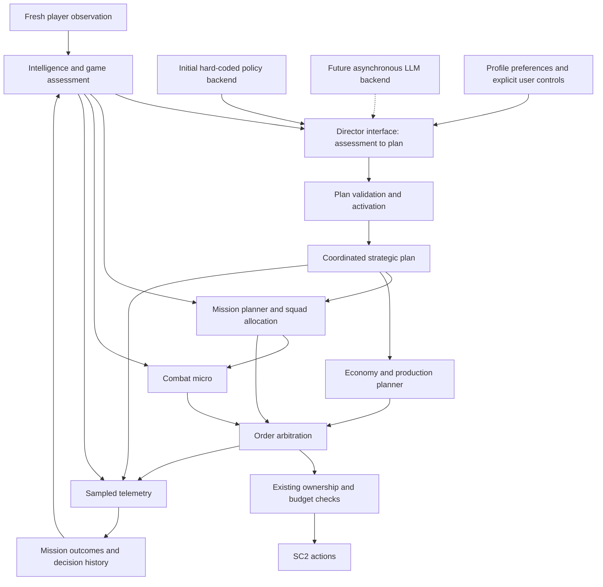

# Adaptive strategy and tactics overhaul

**Status: initial hard-coded implementation delivered; live evaluation pending.**
**Branch:** `feat/adaptive-pressure-tactics`  
**Date:** 2026-10-25

**Review direction:** implement and evaluate a hard-coded strategic director
first. Design replaceable boundaries across the autonomy stack, using LLM-PySC2
as a potential template for more than the director: observation translation,
specialist controllers, action translation, and orchestration may also change.
Keep the advanced strategic responsibilities below in scope. Model integration
is a later evaluation milestone, not a dependency of the first playable version.
Implementation was authorized after review. The initial backend and execution
modules are implemented; see [validation and scope](overhaul-validation.md).

## Goal

Improve the autonomous Protoss bot's performance against VeryHard through a
combination of sound economy, useful scouting, timely pressure, favorable fights,
and denial of the opponent's income. The strategy should emerge from a high-level
assessment of the game and coordinate several tactics at once.

The existing profiles should express preferences for risk, composition, and
investment. They should not lock the bot into one tactic or require an arbitrary
army size regardless of the opportunity in front of it.

The director needs to reason about uncertainty, competing investments, timing,
and simultaneous operations. The initial implementation will express this through
modular policies and explicit candidate-plan scoring. Its interfaces must support
replacing the director independently, replacing specialist controllers, or
eventually adopting a broader LLM-PySC2-style stack. Existing scouting, missions,
micro, and economic execution are useful initial implementations and baselines;
they are not permanent restrictions on the future design.

Success requires new match evidence. Faster decisions, scenario tests, and better
heuristics alone do not establish that the bot beats VeryHard reliably.

## Current state and evidence

The initial review found several problems that compound one another:

| Finding | Consequence | Planned correction |
| --- | --- | --- |
| VeryHard wave assembly requires at least 96 supply and 24 units, with additional composition/intelligence gates. | Early pressure and punishment of exposed expansions can remain unavailable even when locally favorable. | Mission-specific readiness based on observed opposition, role, cohesion, and uncertainty. |
| Groups within 120 distance of a Nexus count as incoming threats. | An army far from home can trigger defensive behavior and economic emergencies. | Local approach detection, separate immediate threats from strategic sightings. |
| Tactical decisions and scouting share the five-second snapshot schedule. | Responses to opportunities and danger are delayed by logging cadence. | Separate observation, combat, tactical, strategic, and telemetry schedules. |
| The opening Probe's route visits friendly base approaches. | The controller's name implies enemy scouting, but it does not obtain the intended opening information. | Explicit enemy-natural/main scouting, followed by a return to mining. |
| Composition adaptation directly changes settings from the current visible army. | Partial sightings can cause inappropriate or persistent tech investment. | Expiring intelligence and bounded production overlays over the user's settings. |
| Production comes after substantial construction, expansion, and upgrade spending. | Available production can remain idle while the army falls behind. | A macro plan that protects opening prerequisites and ongoing combat production. |
| Large supply buffers and early expansion can absorb opening minerals. | The bot pays for capacity it cannot yet use while delaying useful units. | Supply and expansion spending tied to actual production and economic readiness. |
| Fight strength uses maximum air/ground DPS and can count distant friendly units. | A force can appear capable of winning a fight it cannot actually participate in or damage. | Local, target-compatible force comparison including static defenses. |

Six recently inspected saved defeats showed the first completed Stalker between
approximately 4:11 and 5:49; five ended with more than 1,600 gas. These are sampled
observations from existing runs, not controlled results for the proposed changes.
They support investigating production order and resource allocation before
attributing the losses solely to army micro.

Initial working-tree edits exist in `economy_assistant.py`, `scouting.py`, and
`warp_reinforcement.py`, with draft `combat_assessment.py` and `composition.py`
modules. They are incomplete and unvalidated. They must be reviewed against this
architecture before implementation resumes.

## Architecture



### 1. Intelligence and game assessment

Produce one shared assessment from the current observation and explicit memory.
Controllers should consume that assessment rather than independently inventing
different definitions of an incoming army or a safe expansion.

The assessment contains:

- Friendly economy: workers, saturation, income/resource imbalance, production
  capacity, idle production, supply headroom, tech, and upgrades.
- Friendly forces: available units, assigned roles, location, health, fighting
  capability, cohesion, and reinforcement travel distance.
- Enemy intelligence: observed army composition, buildings, bases, tech, and
  last-seen positions/times. Tag-based memory avoids counting the same unit twice.
- Threats: immediate attacks on bases, approaching groups, local combat contacts,
  static defenses, and likely threats indicated by observed tech.
- Opportunities: exposed resource centers, vulnerable workers, unfinished bases,
  safe expansion sites, and recently cleared enemy positions.
- Uncertainty: what is currently visible, remembered, expired, or unexplored.

Enemy memory must expire. Destroyed-unit events remove known units. A visibly
empty base site invalidates the remembered base. A mobile army disappearing into
fog is not proof that it died or that its previous location remains occupied.
The assessment must not access hidden enemy resources or units.

Opening scouting checks the opponent's natural and main when survivable. Later
scouting prioritizes unanswered questions: expansion count, army movement, tech
changes, and the safety of a proposed attack. Observers should avoid threatening
anti-air and refresh economically important sites instead of following a rigid
home-first patrol forever.

### 2. Strategic director

Choose coordinated objectives and an investment posture from the assessment.
The following labels summarize the dominant intention; they do not restrict a
plan to one action or prohibit combining pressure, expansion, and scouting:

| Objective | Typical trigger | Compatible actions |
| --- | --- | --- |
| Stabilize | A credible home attack or a failed local engagement | Defend, reinforce, recover shields, produce needed counters, suspend risky expansion |
| Develop | Weak offensive opportunity and room for safe economic growth | Expand, saturate, add production/tech, scout, screen approaches |
| Pressure | A ready force and a reachable economic target | Main-army pressure, forward scouting, reinforcement, optional denial squad |
| Contain | Enemy defenses make a direct attack unattractive | Hold useful ground outside weapon range, deny outer bases, scout transitions, grow economy |
| Counterattack | A home threat has been repelled and an exposed target is identified | Preserve a home reserve, exploit the opening, reinforce the advancing force |
| Finish | Strong evidence of a beaten main force and limited remaining infrastructure | Destroy known production/income, search cleared sectors, prevent rebuilding |

#### Initial backend: modular strategic policies

Implement the first director as a deterministic planner with a shared world
assessment and persistent decision history. Its responsibilities are:

1. **Interpret the situation.** Distinguish observed facts from hypotheses such as
   an economic opening, imminent timing attack, air transition, or fortified
   defense. Keep supporting observations and expiry times with each hypothesis.
   Unseen territory and a missing enemy army remain uncertainty, not reassurance.
2. **Generate candidate operations.** Policies propose opportunities such as
   attacking an exposed third, preparing a tech timing, recovering an army,
   expanding behind pressure, or scouting before committing. A proposal states
   prerequisites, force/resource requirements, expected benefit, risk, and
   information needed. The library can grow without expanding one giant decision
   function.
3. **Compare opportunity costs.** Score candidates using local force advantage,
   economic value, travel time, reinforcement access, exposure at home, investment
   delay, and uncertainty. Treat estimates as heuristics rather than calibrated
   win probabilities. Keep score components visible for tuning.
4. **Compose a feasible plan.** Allocate a shared army and investment budget
   across compatible operations, with explicit dependencies. Reject conflicting
   allocations, retain sufficient defense, and prevent several individually
   attractive missions from collectively overcommitting the army or resources.
5. **Commit and adapt.** Retain a valid plan until a meaningful opportunity,
   failure, or threat warrants changing it. Use different entry/exit thresholds,
   minimum commitment windows, and emergency interruption. Check whether planned
   benefits occurred before repeating a failed approach.

For example, a plan may keep the main army outside a fortified natural, assign
scouting to the enemy third, and reserve a small denial squad. The denial mission
activates only when scouting confirms its prerequisites. Meanwhile, production
can prepare the counters needed if the enemy changes composition.

#### Shared director contract

Both the initial policy backend and a future LLM backend consume an immutable,
versioned assessment and return the same structured strategic plan:

```text
assessment:
  version, game_loop, observed facts, uncertainty, opponent hypotheses,
  friendly capabilities, map regions, opportunities, active missions,
  recent outcomes, resource constraints, user preferences

plan:
  id, based_on_assessment_version, created_game_loop, expiry_game_loop,
  objectives, priorities, investment/composition targets,
  missions, dependencies, activation/abort conditions,
  commitment window, reassessment triggers, evidence references, brief rationale
```

This is the strategic integration contract. Specialist and action-level
integration have additional contracts described below; every future controller
does not have to express itself as a strategic plan.

Use typed, supported predicates for conditions and stable identifiers for targets
and missions. Directors request capabilities and force budgets; the mission
planner assigns actual eligible units. Do not encode arbitrary executable code
or free-form instructions as conditions.

The validator checks schema, supported capabilities, references, budget/ownership
constraints, and feasibility against the latest observation. It must report why
a plan was rejected or a mission was deferred. Advisory risk estimates should
remain distinct from hard constraints so the validator does not silently replace
the director's strategic judgment with another competing strategy policy.

Use one authoritative active plan. Activation reconciles persistent missions by
ID so a revised composition target does not reset an ongoing attack. A failed or
expired plan cannot leave units without a defined response: continue valid
missions where appropriate, defend immediate threats, and recover exposed squads.

#### Future backend: LLM strategic planning

An LLM director remains a deliberate follow-on option. It should assess the
whole game, compare alternative plans, coordinate simultaneous operations, and
revise assumptions after feedback. Its output can compose supported tactics and
conditional follow-ups rather than merely selecting one of six fixed modes.

The context should contain the compact factual assessment, recent material
events, mission outcomes, explicit uncertainty, and relevant researched tactical
knowledge. Keep model-generated hypotheses separate from authoritative facts.
Provide bounded read-only queries for detailed map, force, or tech information
when needed. The tactic catalog must expose what the execution layer can actually
perform; the model cannot assume unsupported spells or transport micro exist.

Model reasoning runs asynchronously while current missions and fast local
controllers continue. Responses carry the assessment version and a validity
window. Revalidate their assumptions on arrival, reject responses superseded by
a newer decision or critical event, and coalesce updates to avoid an unbounded
request queue. Track wall-clock latency and game-time age separately. Immediate
combat survival never waits for a model call.

Later model integration needs explicit timeout, retry, request/token budget,
and outage behavior. Reuse the initial hard-coded backend for baseline comparison
and bounded fallback. Fallback must be visible in telemetry and preserve valid
mission assignments. Provider/model choice, local versus hosted inference, and
per-match cost limits are later deployment decisions; no model service is being
configured or invoked as part of the first implementation.

Director-only replacement is the smallest useful experiment, not the limit of
the architecture. The broader replacement path in section 7 allows model-driven
economic planning, squad control, building decisions, and action generation when
they demonstrate sufficient reliability and performance.

Explicit `defend`, `regroup`, `push`, and `retreat` commands retain their existing
authority. Automatic secondary missions must not contradict a manual retreat or
a user-provided script target. Existing script input fields remain compatible;
new assessment fields can be additive.

### 3. Mission planner

Translate the strategic plan into persistent missions with disjoint unit
assignments. A mission records:

```text
id, role, priority, assigned tags, target, phase,
minimum force, maximum allocation, created time, expiry,
success condition, abort condition, reason
```

Initial mission types:

- **Scout:** answer a particular intelligence question with an appropriate unit.
- **Screen/defend:** protect a threatened base or approach with compatible units.
- **Main pressure:** move a cohesive force toward an economic or military target.
- **Expansion denial:** send a bounded detachment to attack workers or an exposed
  resource center, or contest a likely expansion site.
- **Contain:** maintain pressure outside a fortified position while seeking a
  better target and preventing uncontested expansion.
- **Reinforce:** assemble arrivals and join a mission without feeding single units.
- **Recover:** withdraw damaged units or a losing squad to a safe recovery point.
- **Search/finish:** clear known structures and inspect distinct candidate sites.

Allocation must reserve enough force for the main mission and credible home
threats before creating a harassment detachment. A secondary squad must satisfy
its own readiness and escape conditions. Its loss should not reset the entire
army; loss of the main force should cancel exposed secondary missions.

Mission phases are assemble, travel, engage/hold, recover, and complete/abort.
Assignments persist across observations but immediately exclude dead,
selected, or released units.

### 4. Fight assessment and micro

Compare forces that can reach the current engagement, with weapon compatibility
and current health. Include nearby defensive structures. Buildings such as
Bunkers need an explicit conservative uncertainty treatment because raw weapon
data alone does not reveal their full threat.

The first implementation uses a bounded heuristic, not a full combat simulator.
It should account for:

- Ground/air target compatibility and attackable unit categories.
- Local force concentration and nearby reinforcements.
- Health/shields, weapon range, and known static defenses.
- Incomplete visibility and whether a withdrawal route is usable.

Micro actions include reachable-target prioritization, distributing fire to
reduce obvious overkill, cooldown-aware kiting, and withdrawing damaged units.
Movement must not repeatedly cancel attacks. A kiting unit must resume its
mission when ready to fire or when its target leaves range.

Advanced spells remain individually opt-in. Profile selection must not silently
enable Blink, Storm, Feedback, Guardian Shield, or Prismatic Alignment.

### 5. Economy and production planner

The strategic plan supplies priorities and composition targets; the economy
controller executes legal, affordable actions.

- Establish a usable opening: supply, Gateway, gas, Cybernetics Core, early units,
  and an economically supportable expansion.
- Keep combat production active while reserving scheduled opportunities for
  necessary infrastructure and upgrades.
- Scale production to available income and idle capacity. Avoid building a large
  production network before it can be supplied with units.
- Tie supply spending to expected near-term consumption and pending Pylons.
- Gate additional expansions on workers, available protection, and current
  threats. Respect configured base limits and resource reserves.
- Adjust gas staffing when the bank is excessive relative to minerals and
  planned spending; restore staffing when demand returns.
- Adapt composition through a temporary overlay, with confidence thresholds and
  expiration. Preserve configured values for disabling adaptation or changing
  profiles. Avoid adding unrelated ground tech in response to an air-only army.
- Prioritize relevant upgrades and tech milestones, then exploit their completion
  as opportunities when the rest of the force is ready.

The planner must also prevent warp-in spending from starving emergency supply,
critical tech, or necessary economic recovery. Spending on separate producers
must still share accurate same-observation accounting.

### 6. Scheduling and order arbitration

Proposed starting cadences, to be measured and tuned:

| Work | Cadence |
| --- | --- |
| Ownership, chat/control changes, action errors, essential observation updates | Every observation |
| Combat micro and immediate danger response | Approximately 0.125–0.25 game seconds, subject to observation availability |
| Macro opportunities | Approximately 0.25 game seconds |
| Mission updates and local tactical assessment | Approximately 0.5–1 game second |
| Strategic objective/composition reassessment | Approximately 2 game seconds, plus material events |
| Full observation serialization and snapshots | Existing five-second logging cadence |

Use game time for gameplay decisions so real-time and accelerated matches apply
the same policy. Do not imply that a timer produces fresh observations faster
than SC2 delivers them.

Within a frame, priority is: user ownership/pausing, emergency survival, active
combat, mission movement, then idle positioning. Macro actions use their own
eligible producers and shared resource budget. The existing `issue` boundary
remains the final authority; no controller bypasses it.

Cache derived assessment data within an observation. Batch ability queries where
appropriate and avoid replacing matching orders. Full-state serialization and
external script execution must not move onto the micro loop. Keep script polling
bounded and reuse its last valid plan between polls.

The two-second strategic interval above applies to the initial local policy
backend. A future LLM backend gets an independent event-driven request schedule,
bounded by measured latency and cost. Its requests must not run at the micro
cadence. Accelerated matches require separate evaluation: several wall-clock
seconds of inference can represent much more game time, so their results cannot
be treated as equivalent to real-time model performance.

### 7. Broader LLM-PySC2-inspired replacement path

Treat LLM-PySC2 as a reference for an autonomy stack, with multiple possible
integration points. Its paper describes combat-command, economic-development,
combat-group, and building roles; its environment translates observations and
textual actions between models and PySC2. This makes it relevant beyond our
strategic director. [Paper, sections 2.1–2.4](https://arxiv.org/html/2411.05348v2)

The repository review used commit
`551c863475c0c4a96a181080974d24b59589e9f3`. The following are inspected source
boundaries and proposed adaptations, not claims that its implementation already
satisfies our requirements:

| Upstream boundary | What was inspected | Proposed boundary here |
| --- | --- | --- |
| [Observation translators](https://github.com/NKAI-Decision-Team/LLM-PySC2/blob/551c863475c0c4a96a181080974d24b59589e9f3/llm_pysc2/lib/llm_observation.py) | Different views for combat groups, commander, and developer, including available actions and recent action feedback | A factual observation model with role-specific views; optional model-oriented text or visual representations |
| [Decision agents](https://github.com/NKAI-Decision-Team/LLM-PySC2/blob/551c863475c0c4a96a181080974d24b59589e9f3/llm_pysc2/agents/llm_pysc2_agent.py) | Configurable teams, observation/action translators, model clients, and communication state | Independently replaceable strategy, economy, scouting, and squad controllers |
| [Action translation](https://github.com/NKAI-Decision-Team/LLM-PySC2/blob/551c863475c0c4a96a181080974d24b59589e9f3/llm_pysc2/lib/llm_action.py) | Configured action vocabularies translated into PySC2 function calls | A capability catalog and typed action intents translated by the environment adapter |
| [Main-agent orchestration](https://github.com/NKAI-Decision-Team/LLM-PySC2/blob/551c863475c0c4a96a181080974d24b59589e9f3/llm_pysc2/agents/llm_pysc2_agent_main.py) | Team observation collection, query threads, and action execution | Scheduling, ownership allocation, shared resource arbitration, and outcome delivery independent of controller implementation |

#### Replacement levels

1. **Director replacement:** a model produces strategic plans; local controllers
   handle economic execution, squads, and micro. This gives the cleanest initial
   comparison with the hard-coded baseline.
2. **Specialist replacement:** replace an economic planner, scout planner, squad
   controller, or construction planner independently. Such a controller may
   produce scoped action intents as well as mission requests. It is not limited
   to asking the director to choose a different mode.
3. **Coordinated model controllers:** model-driven roles cooperate through shared
   observations, assignments, resource grants, and outcome events. One component
   retains authority over actor/resource allocation, preventing two agents from
   independently spending the same gas or redirecting the same units.
4. **Broader stack adoption:** evaluate reusing or replacing observation
   processing, orchestration, action translation, or the environment integration
   itself. This is a separate prototype and compatibility decision, not a promise
   to retain all current internals forever.

#### Contracts worth preserving now

Keep the first implementation simple: ordinary Python modules and typed data
structures are sufficient. Establish these seams as the relevant features are
built; do not implement a distributed agent framework in advance.

| Contract | Required content |
| --- | --- |
| Observation view | Game/version identity, observation sequence, game time, unit/map facts, evidence age, allowed capabilities, recent outcomes; no dependency on live `BotAI`/`Units` objects |
| Controller assignment | Role, mission, allowed actors/capabilities, resource allowance, priority, allocation revision, expiry |
| Action intent | Request ID, controller/assignment revision, source observation, actor/target references, typed action and arguments, preconditions, expiry |
| Execution outcome | Accepted/deferred/rejected request, reason, issued command, and separately any subsequently observed effect |

A future tactical model may request specific movement, attacks, or enabled
abilities through action intents. Current legality, ownership, resource, and
freshness checks apply at execution time. Success at issuing an action is not
confirmation that the desired game effect occurred.

Only one controller owns an actor at a time. Emergency interruption changes the
assignment revision so delayed responses cannot reclaim a squad. Resource grants
share one live accounting authority. Operational messages such as reinforcement
requests or target changes are typed and reference evidence; model conversation
cannot silently mutate authoritative game facts or ownership.

Policy and execution implementations may change. The guarantees that remain are
fog-of-war correctness, explicit human ownership, opt-in combat abilities, legal
actions, accurate spending, and observable failure handling.

#### Adaptation work before adopting upstream components

- **Shared human controls:** the upstream main agent includes camera/selection
  management and explicit control-group recall. Our present raw-action approach
  preserves human selection. Port applicable ideas through raw unit-tag actions
  where possible; direct environment adoption requires new human-control
  acceptance, rather than assuming those interactions are compatible.
  [Main-agent source](https://github.com/NKAI-Decision-Team/LLM-PySC2/blob/551c863475c0c4a96a181080974d24b59589e9f3/llm_pysc2/agents/llm_pysc2_agent_main.py#L396)
- **Scheduling:** upstream launches query threads but also has a bounded waiting
  loop inside its main step. Review/adapt this for our continuously running
  real-time match. A threaded query alone does not establish that control is
  nonblocking or that decisions are fresh on arrival.
  [Main loop](https://github.com/NKAI-Decision-Team/LLM-PySC2/blob/551c863475c0c4a96a181080974d24b59589e9f3/llm_pysc2/agents/llm_pysc2_agent_main.py#L305)
- **Dependency and runtime compatibility:** the inspected package ships PySC2 and
  depends on `s2clientprotocol`, while this project pins BurnySC2 and
  `pys2clientprotocol`. A direct adoption experiment belongs in an isolated
  environment. Do not install competing protocol distributions into this
  working environment or assume equivalent current Windows behavior.
  [Upstream package definition](https://github.com/NKAI-Decision-Team/LLM-PySC2/blob/551c863475c0c4a96a181080974d24b59589e9f3/setup.py)
- **Performance:** the paper's full-game experiments report worse results when
  additional low-level control is handed to the tested models. Wider replacement
  is an option to evaluate component by component, not an automatic improvement.
  [Paper, section 3.1](https://arxiv.org/html/2411.05348v2)

Initial development remains hard-coded. It produces working capabilities,
contracts, recorded scenarios, and a measurable baseline, all of which remain
useful if a later stack replaces several controllers at once.

## Profiles and composition

Profiles become preferences consumed by the director and macro planner:

| Profile | Preference |
| --- | --- |
| Balanced | Sustainable pressure, flexible counters, normal home reserve |
| Pressure | Earlier economical attacks, more frequent denial opportunities, bounded commitment |
| Fortress | Greater defensive reserve, safer fights, counterattack after a successful hold |
| Robotics | Preserve and reinforce a ground-tech core; match Immortal/Colossus investment to observed targets |
| Air | Develop an air core, exploit mobility, assess anti-air exposure, retain needed ground protection |

All profiles can scout, defend, pressure, deny, recover, and finish. A pressure
profile must still defend a dangerous attack; a fortress profile must exploit a
safe counterattack rather than wait indefinitely.

## Example coordinated plans

**Enemy expands behind a fortified natural:** the director selects pressure or
containment. The main force avoids the fortified entrance; scouting checks the
third. If the third is exposed and the force budget permits it, a denial squad
attacks there while reinforcements assemble safely.

**Enemy air transition appears during ground pressure:** remember the sighting,
raise appropriate anti-air production, and reassess each squad's ability to
fight. Continue pressure on a safe ground target if it remains profitable;
withdraw a squad threatened by air it cannot damage.

**Small raid at home during an established attack:** assign nearby compatible
reserves or new warp-ins to defense if sufficient. Continue the main mission.
If the raid is actually a large attack, replace the plan with stabilization.

**Main army wins a defensive engagement:** evaluate surviving force, shields,
reinforcements, and known enemy bases. Counterattack an exposed economic target
when justified; recover first if the surviving force cannot sustain another fight.

## Module boundaries and migration

Names below are proposed boundaries, not a requirement to create a separate file
for every class.

| Module | Responsibility |
| --- | --- |
| `scouting.py` / an intelligence module | Scouting assignments, enemy memory, evidence freshness |
| `combat_assessment.py` | Target-compatible force comparison and local threat evaluation |
| `strategy_director.py` | Backend interface, active-plan lifecycle, strategic history, reassessment |
| `strategy_policies.py` | Initial hard-coded candidate generation, scoring, and compatible-plan composition |
| `strategic_plan.py` | Shared assessment/plan contracts, typed conditions, validation, activation rules |
| `llm_director.py` (later) | Asynchronous model backend, context assembly, response freshness, request budgets |
| Observation/action contracts and adapter | SDK-independent views, capability/assignment/action-intent records, outcomes, and conversion to current runtime objects |
| Specialist controller backends (later) | Independent or coordinated model-driven economy, scouting, squad, or building control through scoped intents |
| `missions.py` | Mission lifecycle, squad allocation, targets, abort/reinforcement rules |
| `composition.py` | Temporary counter-composition targets and tech demand |
| `tactics.py` | Tactical integration and combat micro; gradually shed strategic responsibilities |
| `army_waves.py` | Cohesion, staging, and reinforcement mechanics for assigned forces |
| `endgame_sweep.py` | Search/finish behavior under mission ownership |
| `economy_assistant.py` | Macro execution, allocation, abilities, and the existing order boundary |
| `warp_reinforcement.py` | Legal reinforcement actions directed by mission and spending priorities |
| `runtime.py` | Scheduling, observation integration, diagnostics, and telemetry |

Migrate existing wave and endgame behavior behind mission ownership. Avoid leaving
two independent controllers commanding the same army. Preserve manual control
and existing configuration/script contracts while moving responsibilities.

The listed modules describe the initial implementation. Later LLM-PySC2-inspired
adoption may replace multiple modules behind the observation/action contracts;
the strategic-plan interface is not the only extension point.

## Implementation sequence and acceptance criteria

1. **Review this design and reconcile preliminary edits.** Agree on the shared
   director contracts and the hard-coded-first scope before extending the current
   changes. Record the old behavior and saved-log evidence used for comparison.
2. **Assessment and intelligence.** Add shared data contracts, local threat
   detection, expiring enemy memory, and useful scouting routes. Accept when fog,
   stale sightings, duplicate tags, ownership, and false home alarms are covered.
3. **Macro and composition foundations.** Repair opening spending, production
   priorities, gas balancing, and adaptive targets. Accept when resource reserves,
   configured toggles, tech prerequisites, and counter-production work in scenario
   tests without permanently mutating settings.
4. **Initial director and mission lifecycle.** Implement modular candidate
   generation/scoring, feasible plan composition, stable commitments, squad
   allocation, and interruption through the shared director contract. Accept when
   simultaneous missions have disjoint ownership, shared budgets, and explicit
   success/abort conditions. The first playable version has no model dependency.
5. **Pressure, denial, and fight selection.** Replace universal difficulty gates
   with mission readiness; implement economic target selection and bounded
   secondary attacks. Accept when a small favorable pressure force can launch,
   an unsafe assault is rejected, and a raid does not unnecessarily recall the
   entire army.
6. **Micro and scheduling.** Separate control from snapshot cadence, reduce
   redundant orders, and add cooldown-aware combat execution. Run protocol and
   lifecycle tests for all runtime-boundary changes.
7. **Integration, documentation, and gameplay evaluation.** Run quality gates,
   update strategy documentation, and evaluate new matches under the existing
   Windows runbook. Tune using recorded evidence rather than increasing arbitrary
   army thresholds after each loss.
8. **Evaluate an LLM backend after the initial baseline.** First use recorded
   assessments and a shadow mode that proposes plans without issuing orders.
   Check executable-plan validity, evidence use, stale-response handling, latency,
   and cost. Then compare live LLM and hard-coded directors using the same
   executor and evaluation matrix. Promotion depends on measured benefit. This is
   a subsequent milestone, not a prerequisite for completing stages 1–7.
9. **Evaluate broader LLM-PySC2-inspired adoption.** Compare director-only,
   specialist, and coordinated-controller variants before considering a full
   environment migration. Start each candidate in an isolated/shadow setup and
   replace one boundary at a time so regressions can be attributed. Require the
   same gameplay and ownership criteria plus latency/cost measurements. A future
   whole-stack replacement remains possible if the evidence supports it.

## Validation

Scenario tests should cover early aggression; mixed and air-only armies; static
defenses; enemy expansion under construction; partial and stale sightings;
selected/released units; a home raid during pressure; failed harassment; lost
main forces; recovery; resource starvation; and changing profiles or disabling
automation during active missions.

Director scenarios also need competing priorities: two attractive attacks with
insufficient shared force; an expansion investment that would delay a necessary
counter; a scouting-dependent mission; a changed target while a plan is pending;
and a small failure that should alter one mission without resetting the others.
Contract tests should use a fake delayed backend to establish plan freshness and
activation semantics without a paid model connection.

For a later LLM backend, test malformed plans, unsupported capabilities,
invented evidence/targets, stale and out-of-order responses, timeout/outage, and
budget exhaustion. Record concise reasons and evidence references, accepted
plans, and observed outcomes so strategy quality can be evaluated independently
of execution failures. A structurally valid model response is not evidence of a
good strategy.

For specialist or broader-stack experiments, add tests for conflicting actor
claims, duplicate spending, expired assignments, messages based on different
observations, emergency handover during inference, and accurate correspondence
between adapter actions and observed effects. Compare against the same initial
hard-coded controllers; changing several components at once needs separate
ablation runs to identify what actually improved.

Use replayable sampled observations for decision inspection where feasible.
They can expose false alarms, incorrect target selection, and idle production,
but cannot simulate the counterfactual outcome of issuing different actions.

Run the repository's required lint, formatting, type, coverage, packaging, and
runtime checks. The pre-overhaul suite passed **195 tests**. The implemented
baseline passes **274 tests with 91.10% coverage** using a repository-local
temporary directory; see the [validation record](overhaul-validation.md). The
current environment denied execution of the installed `uv` binary, and the
existing environment lacks `hatchling`. Locked-environment and packaging
validation remain pending.

For new matches, compare a fixed matrix of map, opponent race/build, difficulty,
profile, and available seed controls. Use repeated runs rather than a single win.
Record:

- Win/loss and duration, with exact binary/data identity.
- First combat unit, first meaningful pressure, expansion, and tech timings.
- Production idle time, supply blocking, and resource-bank trends.
- Army resource trades and avoidable unit losses.
- Enemy bases canceled/destroyed and observed worker losses.
- Mission transitions, abort reasons, and denied action requests.
- Controller execution time and command volume, separated from logging overhead.
- Plan changes, failed prerequisites, score components, and mission outcomes;
  for later model trials, inference latency, plan age, invalid-response rate,
  fallback frequency, and cost per match.

Gameplay launches and human-control acceptance must follow the existing runbook
and manual handoffs. If the desktop is unavailable, report live validation as
pending. Do not use `--probe` or synthetic tests as gameplay acceptance.

## Research and policy provenance

Initial references found during the review:

- [Blizzard: Game Guide — Protoss Attacks](https://news.blizzard.com/en-us/article/5963107/game-guide-protoss-attacks).
  Supports scouting before commitment, reinforcing attacks, and targeting enemy
  economy/production. Its historical build details are not current-patch timings.
- [Harstem: Best 2023 Protoss vs Terran Build Order Guide](https://www.youtube.com/watch?v=cnWR4Ka64J4).
  A primary creator reference for a three-Gate Blink opening, with example replays
  linked by the author. Search metadata was available; the full video was not
  reviewed in this session.
- [Harstem: 2025 Protoss vs Terran Build Order Guide](https://www.youtube.com/watch?v=sZjbBter7Ok).
  A newer primary creator reference advertising a flowchart and replays. Detailed
  matchup rules still need verification against the original material before
  being encoded as sourced recommendations.

The proposed architecture and numeric thresholds are engineering decisions.
They should not be represented as exact implementations of professional play.
Further research should map each adopted tactic to its preconditions, information
requirements, resource commitment, execution, abort condition, and follow-up.

Relevant primary research for the future director boundary:

- [SwarmBrain (2024)](https://arxiv.org/abs/2401.17749) separates LLM macro strategy
  from a fast condition-response controller because of inference latency. Its
  experiments use Zerg against Terran; the architecture is informative, but the
  reported outcomes do not validate this Protoss implementation.
- [Adaptive Command](https://arxiv.org/abs/2508.16580) combines an LLM strategic
  advisor with behavior-tree execution. Its human-collaboration setting supports
  investigating that separation, not assuming autonomous VeryHard performance.
- [Hierarchical Expert Prompt (2025)](https://arxiv.org/abs/2502.11122) reports
  defeating Elite in TextStarCraft II using hierarchical task handling and expert
  knowledge. This motivates testing an informed LLM planner, with the different
  environment and evaluation conditions kept explicit.
- [LLM-PySC2](https://arxiv.org/abs/2411.05348) investigates asynchronous LLM
  interaction and reports inconsistent decisions and collaboration problems.
  It reinforces the need to evaluate grounded plans, execution compatibility,
  and failure handling rather than assuming model intelligence alone suffices.

SwarmBrain, Adaptive Command, and Hierarchical Expert Prompt were reviewed at the
abstract level. LLM-PySC2 was additionally reviewed in its framework/full-game
evaluation sections and the source files linked in section 7. Its published
capabilities and the inspected repository implementation are distinct evidence;
neither establishes compatibility with this bot. The specific contracts,
validation rules, scheduling choices, and migration path in this plan are our
engineering proposal, not a reproduction of any one paper.

## Scope decisions for review

The first overhaul uses the modular hard-coded director with the current Protoss
unit capabilities, local-game integration, and explicit spell opt-ins. It
establishes an extensible mission system and implements the tactics listed above.
The observation, assignment, plan, and action contracts preserve a path to a
broader model-driven stack, including LLM-PySC2-inspired replacements beyond the
director, without requiring a model service for the initial baseline. Transport-drop
juggling, new spell-heavy unit controllers, and learned combat simulation can be
added as separate capabilities once economy and coordinated tactics are measured.

The central design decision is to replace the current single army-wide policy
with coordinated controllers behind replaceable boundaries, starting with a
hard-coded strategic director and persistent missions. Ownership and action
guarantees remain mandatory even when their implementation changes. Initial
policy rules are the first backend and future fallback, not a permanent
architectural restriction.
The user authorized implementation after review. The initial hard-coded backend
is implemented. Stages 8 and 9 remain subsequent model-evaluation milestones;
no model provider or alternate game environment is connected. Live stage-7
acceptance remains pending. See [validation and scope](overhaul-validation.md).


## Live follow-up: targeted expansion pressure

The user requested more deliberate expansion denial after the first live trials.
This revision connects the existing scout, assessment, director and mission
boundaries instead of adding a separate all-army override:

1. Record occupied/empty/unknown expansion sites and inspection times. Schedule
   overdue Observer visits with persistent destinations and threat backoff.
2. Distinguish enemy expansions from the starting main. Keep a base's tag through
   fog, retain observed defenders, and favor vulnerable expansions and construction.
3. Use the main force against the highest-value safe expansion, or detach a bounded
   mobile squad for a second visible expansion. Preserve the main army's heavy
   units and abort raids that encounter unfavorable local resistance.
4. Log expansion inspection, advancing force and denial-squad samples separately.
   Movement and target-clearance evidence do not by themselves prove economic damage.
5. Freeze one committed gameplay revision for three concurrent pressure-versus-
   VeryHard-Terran matches on the same map and eight-loop step. Assess the full
   batch before changing tactics; preserve separate results for each revision.

Synthetic cases cover loss of vision, empty-site revisits, threatened scout
routes, light versus fortified guards, and heavy-unit retention. Human ownership
and individually opt-in abilities continue to apply. Self-play is a possible
later evaluation mode: the installed SDK supports two bots, but this runtime
currently controls one participant and needs a separate multi-client lifecycle.
